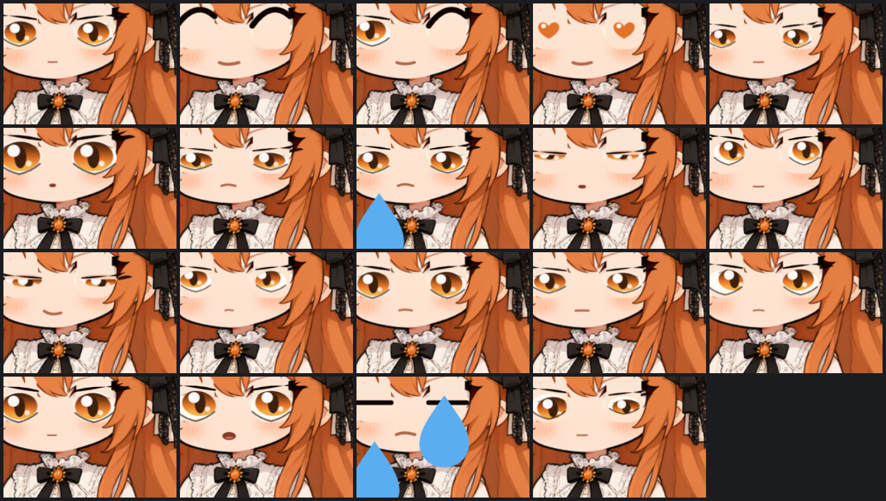
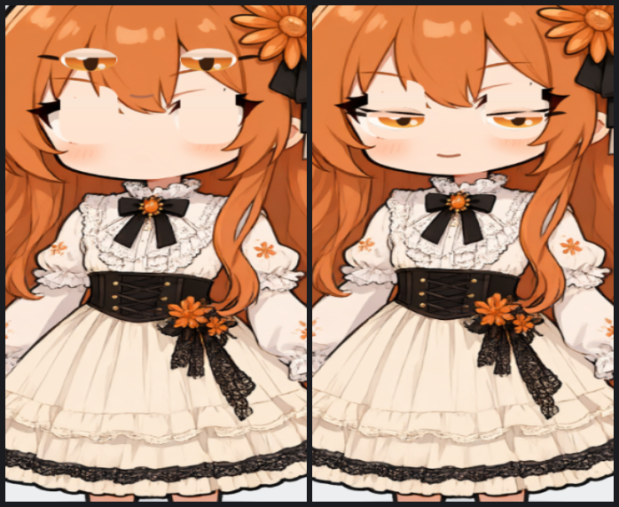

# Coopanion 自定义形象流水线

给 **Coopanion 桌宠**做一套自己的 Q 版形象：从一张立绘画稿出发，做出会呼吸、会眨眼、会说话、会走会坐、有 19 种表情的形象包。

这个仓库是**流水线本身**——脚本、判定标准、以及一份照着做就能复现的流程文档。目标是让**别的 AI（或人）拿到一个新角色时，不需要再从零踩坑**。

```
docs/PIPELINE.md    ← 核心：分 9 步的完整流程（先读这个）
docs/PITFALLS.md    ← 24 个坑：症状 → 原因 → 修法
docs/CASE-claude.md ← 一个完整案例（克劳德娘）的全部实测数字
examples/claude/    ← 做好的成品包，可以直接装进 Coopanion
```

| 静态 | 眨眼三帧 | 19 种表情 |
|---|---|---|
|  |  |  |

| 脸部（4.2×） | 坐姿 | 一次真实发生的"五官错位"修复 |
|---|---|---|
|  |  |  |

---

## 它到底做了什么

Coopanion 的形象包（`api 2`）是一个能自绘的小程序：`figure.js` 导出 `createXxxBody()`，每帧拿到 `frame`（视线、眨眼、说话开合、走路双脚位置、坐姿、朝向、倾斜…），自己把形象画出来。

本项目提供两条**经过验证的**做法，以及支撑它们的工具：

1. **整身图 + 网格变形（warp）**：一张透明底立绘当贴图，用网格变形做腿（走路）、裙摆、头发。**不要切件**——单张美术切开会留下空洞（见 PITFALLS #14）。
2. **五官矢量化**：把贴图上的眼睛/嘴抹成光皮，改用 SVG 逐帧画。只有这样眨眼才自然、19 种表情才做得出来、风格才不会跳变。

配套工具（零依赖 Node，只用 `node:zlib` 自己解 PNG）：

| 命令 | 作用 |
|---|---|
| `node tools/prep.mjs probe` | 白底抠透明 → 裁边 → 量五官/轮廓锚点（出调试图 + `_probe.json`） |
| `node tools/measure.mjs --write` | 把眼睛/眉毛/嘴抹成光皮 → `assets/portrait.png` + `measure.json` |
| `node tools/profile.mjs` | 逐行左右边界（量腰、裙摆下沿、腿的位置） |
| `node tools/grid.mjs` | 给图叠带坐标的网格（肉眼对坐标用，但**别靠肉眼反推**） |
| `node tools/manifest.mjs` | 模板 + `figure.meta.json` → `figure.json`（带回读校验） |
| `node tools/compose.mjs` | `model.json` + `figure.body.part.js` → `figure.js`，并生成 `tex/` `thumbs/` |
| `node tools/shot.mjs` | **离线逐帧截图**（Electron 跑真实 `kit/body.js`，与桌面上同引擎） |
| `node tools/zoom.mjs` / `montage.mjs` / `diffbox.mjs` | 放大看细节 / 多图平铺 / 像素级对比 |

---

## 快速开始

前置：Node ≥ 22；一份 **Coopanion 工作副本**（离线预览要用它的 `web/kit/*`；本仓库不含它的代码）。

```bash
# 1. 把你的立绘放到 <work>/src/generated.png（透明底或纯白底都行，整身、正面站姿最佳）
mkdir -p my-figure/src
cp my-art.png my-figure/src/generated.png

# 2. 量点：出调试图 src/_probe.png 和数值 src/_probe.json
node tools/prep.mjs --work my-figure probe

# 3. 按量出来的数值改 tools/measure.mjs 顶部的 P（脸框、两眼、嘴、肤色），然后抹脸
node tools/measure.mjs --work my-figure --write        # → assets/portrait.png + measure.json

# 4. 写 model.json / figure.meta.json / figure.body.part.js（照 examples/claude 抄）
node tools/manifest.mjs --work my-figure                # → figure.json
node tools/compose.mjs  --work my-figure                # → figure.js / tex/body.png / thumbs/cover.png

# 5. 离线看一眼（这一步是唯一能"看见"的办法）
node tools/shot.mjs my-figure/shots/idle.png "still=1&noblink=1&frames=40" 760 980 \
     --work my-figure --coopanion /path/to/Coopanion
```

装进 Coopanion：把那 5 个文件（`figure.json` `figure.js` `model.json` `tex/` `thumbs/`）拷到
`<Coopanion>/build/data/home/companion/data/figures/<id>/`，再把 `build/data/home/companion/config.json` 里
`worlds.desktop-pet.skin.figure` 改成你的 `<id>`，重启 App。

---

## 适用边界（先说清楚，省得白干）

这套办法**能做**：

- 单张整身立绘 → 会呼吸/眨眼/说话/走/坐/被拎起来的桌面宠物
- 19 种表情（喜怒哀乐、心形眼、螺旋眼、半瞑、挤眼…）＋ 18 种动作词
- 头发、裙摆随动作轻微摆动

**做不了 / 代价很大**：

- **四肢关节**（抬手挥手、屈膝）。单张图里手的位姿是画死的，切成部件会在原位留洞。真要做，得让生图模型**另外画手臂/腿的分离素材**，或者换 Cubism 那一套。
- **转头 / 侧脸**。贴图是正面，转过去只能整体旋转。
- **改画风**。整套动画都长在你那张原画上。

还有一个前提：**原画本身要合格**。正面、整身、四肢不交叠、眼睛清晰可见、纯色背景。见 `docs/PIPELINE.md` 第 2 步的验收清单。

---

## 仓库内容

```
lib/            png.mjs（PNG 编解码）img.mjs（裁剪/缩放/抠图盒/主色）workdir.mjs（--work 解析）
tools/          prep / measure / profile / grid / explore / manifest / compose / shot / zoom / montage / diffbox
tools/harness/  离线预览页 + Electron 主进程（截图用）
templates/      figure.template.json —— 19 表情 / 18 动作的多语言词表骨架
examples/claude/一个完整成品：原图、量点结果、手写的 figure.body.part.js、打好的包
docs/           PIPELINE.md（流程）PITFALLS.md（坑）CASE-claude.md（案例数字）
test/           lib 的自检（node --test）
```

---

## 关于许可证与素材

- 代码：**MIT**（`LICENSE`）。`lib/png.mjs` 与 `lib/img.mjs` 是照 PNG/位图规范重写的，没有引用 Coopanion 的 AGPL 代码——这样本仓库才能整体 MIT。离线预览会 **import** Coopanion 的 `web/kit/*`（运行时依赖，不是拷贝）。
- 本项目是**非官方工具**，与 Pal-AI-Lab / Anthropic 无隶属关系。Coopanion 与 Claude 的名称与商标归各自所有者。
- `examples/claude/` 里的形象是 **AI 生成的同人形象**：角色原型来自 B 站「Claude 娘」二创，设计版权归原作者；如果要商用请自行确认授权。
